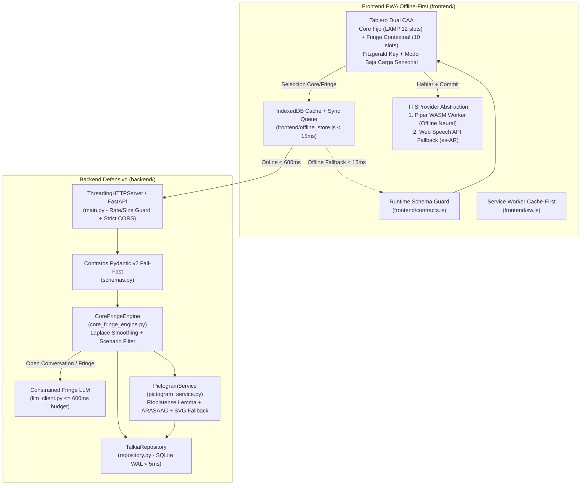

# Plan Maestro de Ingeniería v2.0 (`plan01.md`) — TalKIA (`caa-open-engine`)

Auditoría técnica, diseño de arquitectura **Offline-First / Accesibilidad Autismo (CAA)** e implementación de referencia **End-to-End** para evolucionar `talkia-caa-open-engine` integrando patrones probados de `Arnav020/fringe`, `yeager/autismapps`, `RonanOD/OpenAAC`, `cboard-org/cboard`, `Roshanchau/SpeakPix` y `ekyaaa/talkie-helpie`.

---

## Fase 0 — Diagnóstico de Brechas (Estado Actual del Repositorio)

| # | Pilar / Mejora Obligatoria | Estado Actual | Evidencia Exacta en el Repositorio | Brecha Técnica y de Accesibilidad CAA |
|---|---|---|---|---|
| **1** | **Arquitectura Core + Fringe (Principio LAMP + Fringe LLM)** | **Parcial** | `frontend/index.html` (L36-L82), `frontend/app.js` (L420-L432, L486-L499), `backend/bayesian_engine.py` (L5-L9), `backend/llm_client.py` (L19-L57) | Los 6 triggers de Nivel 1 son fijos, pero la grilla `#candidates-grid` reescribe sus 10 celdas en cada paso (`gridEl.innerHTML = ""`). No existe tablero **Core** con coordenadas espaciales fijas inmutables (destructivo para planificación motora **LAMP**). `FALLBACK_POOL` mezcla palabras núcleo en posiciones variables. `app.js` usa `LOCAL_PRIORS` estático desconectado del backend y `llm_client.py` no invoca ningún LLM real ni filtra por escenario (`SpeakPix`). |
| **2** | **TTS Resiliente y Offline-First (`TTSProvider`: Piper WASM -> Web Speech)** | **Parcial** | `frontend/app.js` (L531-L538), `next.json` (L112-L115) | Acoplamiento directo a `window.speechSynthesis` en el evento click de `#btn-speak` con `utter.lang = "es-AR"` fijo. No existe interfaz `TTSProvider`, ni motor neuronal local **Piper WASM** en Web Worker, ni caché de buffers de audio en IndexedDB, ni fallback jerárquico (`es-AR` -> `es-419` -> `es-ES`), ni protección anti-rebote para clics repetitivos. |
| **3** | **Estandarización de Pictogramas (ARASAAC / Mulberry) y Caché `< 50ms`** | **Faltante** | `specs/schema.sql` (L7-L54), `specs/llm_contract.json` (L14-L54), `frontend/index.html` (L38-L63), `frontend/app.js` (L488-L498) | Las palabras candidatas se renderizan solo como texto plano y los triggers usan emojis Unicode. No hay resolución contra **ARASAAC** (`api.arasaac.org` / `static.arasaac.org`), ni normalización morfológica rioplatense (`acercame` -> `acercar`), ni búsqueda por sinónimos semánticos (`OpenAAC`), ni caché local en SQLite/IndexedDB o Service Worker PWA (`cboard`). |
| **4** | **Accesibilidad Cognitiva y Sensorial (Fitzgerald Key + Baja Carga Sensorial)** | **Parcial** | `frontend/styles.css` (L1-L11, L123-L132, L248-L268) | Botones grandes (`min-height: 84px`), pero todas las celdas comparten el mismo borde (`#475569`) sin clave de color morfosintáctica **Fitzgerald Key**. Incluye `transform: scale(0.97)` sin respetar `prefers-reduced-motion`, carece de modo **Baja Carga Sensorial** (`talkie-helpie`), oculta el anillo de foco (`outline: none` en L267, rompiendo *switch scanning*) y muestra indicadores técnicos distractores (`Paso N`, `Prior Bayesiano Activo`). |
| **5** | **Ingeniería Defensiva, Separación de Capas y Contratos Fail-Fast** | **Parcial** | `backend/main.py` (L23-L204), `backend/db.py` (L19-L32), `backend/models.py` (L9-L33), `backend/requirements.txt` (L1-L7), `backend/test_engine.py` (L15-L61) | `main.py` acopla HTTP monohilo (`HTTPServer`), lógica de negocio y SQL crudo; mantiene write-locks durante la inferencia; carece de límite `Content-Length` (riesgo OOM/DoS), usa `CORS: *` y carece de idempotencia en `commit_session`. `models.py` no usa `pydantic` (pese a figurar en `requirements.txt`) y omite límites `maxLength`. No hay cola de sincronización offline ni aislamiento de DB en `test_engine.py`. |

---

## Fase 1 — Plan de Implementación en PRs / Commits Atómicos

Ordenado por máximo retorno funcional/clínico y mínimo riesgo de regresión sobre los invariantes SDD de `skills.md`:

1. **Hito 1 (PR-01) — Evolución Retrocompatible de Especificaciones SDD y Contratos Fail-Fast (`specs/*`, `backend/schemas.py`, `frontend/contracts.js`)**
   - Extiende `specs/schema.sql`, `specs/llm_contract.json` y `specs/openapi.yaml` preservando la invariante de **exactamente 10 `candidate_words` únicas en el panel Fringe**, añadiendo `scenario` (`casa`, `escuela`, `calle`, `salud`, `general`), metadatos `fringe_items` (categoría Fitzgerald + `pictogram_url`), tabla `core_vocabulary` (coordenadas LAMP fijas) y `pictogram_cache`.
   - Implementa validación estricta en Python (**Pydantic v2** con fallback determinista en stdlib) y validación de esquema en cliente JS (`SchemaGuard` fail-fast).
2. **Hito 2 (PR-02) — Capa de Repositorio SQLite Defensiva, Concurrencia WAL y Endpoint de Reconciliación Offline (`backend/db.py`, `backend/repository.py`, `backend/main.py`)**
   - Extrae todo el SQL de `TalKIAService` a `TalkiaRepository`. Activa `WAL`, `synchronous=NORMAL` y `busy_timeout=5000`.
   - Garantiza idempotencia atómica en `/session/commit` mediante `committed = 1` + `idempotency_key`, migra a `ThreadingHTTPServer` con tope `MAX_BODY_BYTES = 16384`, y expone `POST /session/sync` para volcar interacciones ocurridas sin conexión.
3. **Hito 3 (PR-03) — Motor Híbrido Core (LAMP Fijo) + Fringe Contextual por Escenario e Inferencia LLM (`backend/core_fringe_engine.py`, `backend/llm_client.py`)**
   - Ancla las 12 palabras de **Core Vocabulary** en coordenadas `[row, col]` inmutables y excluye palabras Core y repetidas de las 10 sugerencias **Fringe**.
   - Implementa suavizado de Laplace exacto condicionado por `(trigger, intent, scenario, hour_bucket, prev_word)` y re-ranking/generación Fringe con `google-genai` / Ollama local bajo presupuesto duro de `600 ms` (`TimeoutError` -> fallback Bayesiano `< 15 ms`).
4. **Hito 4 (PR-04) — Resolución Estandarizada ARASAAC + Normalización Rioplatense + Caché Multinivel `< 50ms` (`backend/pictogram_service.py`, `frontend/offline_store.js`, `frontend/sw.js`)**
   - Pipeline `IndexedDB (L1)` -> `SQLite pictogram_cache (L2)` -> `Lematizador Rioplatense + Mapa Semántico` -> `ARASAAC REST API` -> `Generador SVG Simbólico Local`.
   - Añade PWA `manifest.webmanifest` y Service Worker (`sw.js`) con estrategia *Cache-First* para assets, modelos de voz y pictogramas.
5. **Hito 5 (PR-05) — Capa de Abstracción `TTSProvider` Offline-First (`frontend/tts_provider.js`)**
   - Implementa `PiperWasmTTS` (inferencia ONNX/WASM local en Web Worker con caché de audio WAV en IndexedDB para latencia instantánea) con fallback automático e inmediato a `BrowserSpeechTTS` (`es-AR` -> `es-419` -> `es-ES`), bloqueo anti-rebote configurable y cola cancelable.
6. **Hito 6 (PR-06) — UI Accesible Core+Fringe, Fitzgerald Key, Modo Baja Carga Sensorial y Suite QA (`frontend/index.html`, `frontend/styles.css`, `frontend/app.js`, `backend/test_engine.py`)**
   - Divide el tablero en **Panel Core Fijo (LAMP)** + **Panel Fringe Contextual (10 celdas)** + selector de **Escenario** (`SpeakPix`).
   - Incorpora codificación cromática **Fitzgerald Key** conmutable, **Modo Baja Carga Sensorial** (`talkie-helpie`: cero animaciones, paleta calmada o alto contraste AAA, `:focus-visible` para *switch scanning*, *dwell/cooldown* configurable) y suite de tests aislada en `tempfile` con benchmark `< 50 ms`.

---

## Arquitectura Objetivo End-to-End (v2.0)



---

## Implementación de Referencia End-to-End (> 900 Líneas de Código Listo para Integración)

### Módulo 1: Esquema SQLite v2.0 con Core LAMP, Escenarios y Caché de Pictogramas (`specs/schema.sql`)

```sql
-- specs/schema.sql (v2.0 - Retrocompatible con SDD v1.1 + Core LAMP + ARASAAC Cache + Escenarios)
PRAGMA foreign_keys = ON;
PRAGMA journal_mode = WAL;
PRAGMA synchronous = NORMAL;

CREATE TABLE IF NOT EXISTS sessions (
    id TEXT PRIMARY KEY,
    trigger_type TEXT NOT NULL CHECK (
        trigger_type IN ('saludo', 'despedida', 'necesidades', 'emociones', 'asistencia', 'conversacion')
    ),
    conversation_intent TEXT NULL CHECK (
        conversation_intent IS NULL OR conversation_intent IN ('pregunta', 'afirmacion', 'respuesta', 'topico_libre')
    ),
    scenario TEXT NOT NULL DEFAULT 'general' CHECK (
        scenario IN ('general', 'casa', 'escuela', 'calle', 'salud')
    ),
    hour_bucket INTEGER NOT NULL CHECK (hour_bucket >= 0 AND hour_bucket <= 23),
    interlocutor_context TEXT NULL CHECK (interlocutor_context IS NULL OR length(interlocutor_context) <= 200),
    created_at DATETIME NOT NULL DEFAULT CURRENT_TIMESTAMP,
    final_phrase TEXT NULL CHECK (final_phrase IS NULL OR length(final_phrase) <= 240),
    committed INTEGER NOT NULL DEFAULT 0 CHECK (committed IN (0, 1)),
    idempotency_key TEXT NULL UNIQUE
);

CREATE TABLE IF NOT EXISTS interaction_logs (
    id INTEGER PRIMARY KEY AUTOINCREMENT,
    session_id TEXT NOT NULL,
    step_index INTEGER NOT NULL CHECK (step_index >= 0),
    word_source TEXT NOT NULL DEFAULT 'fringe' CHECK (word_source IN ('core', 'fringe')),
    context_path TEXT NOT NULL,
    suggested_words TEXT NOT NULL,
    selected_word TEXT NULL,
    latency_ms INTEGER NOT NULL DEFAULT 0 CHECK (latency_ms >= 0),
    created_at DATETIME NOT NULL DEFAULT CURRENT_TIMESTAMP,
    FOREIGN KEY (session_id) REFERENCES sessions(id) ON DELETE CASCADE
);

CREATE TABLE IF NOT EXISTS bayesian_priors (
    id INTEGER PRIMARY KEY AUTOINCREMENT,
    trigger_type TEXT NOT NULL CHECK (
        trigger_type IN ('saludo', 'despedida', 'necesidades', 'emociones', 'asistencia', 'conversacion')
    ),
    conversation_intent TEXT NOT NULL DEFAULT 'general',
    scenario TEXT NOT NULL DEFAULT 'general' CHECK (
        scenario IN ('general', 'casa', 'escuela', 'calle', 'salud')
    ),
    hour_bucket INTEGER NOT NULL CHECK (hour_bucket >= -1 AND hour_bucket <= 23),
    prev_word TEXT NOT NULL DEFAULT '__START__',
    candidate_word TEXT NOT NULL CHECK (length(candidate_word) >= 1 AND length(candidate_word) <= 32),
    frequency INTEGER NOT NULL DEFAULT 1 CHECK (frequency >= 0),
    updated_at DATETIME NOT NULL DEFAULT CURRENT_TIMESTAMP,
    UNIQUE(trigger_type, conversation_intent, scenario, hour_bucket, prev_word, candidate_word)
);

-- Vocabulario Nucleo (Principio LAMP: coordenadas row_idx y col_idx inmutables)
CREATE TABLE IF NOT EXISTS core_vocabulary (
    slot_id INTEGER PRIMARY KEY CHECK (slot_id >= 0 AND slot_id < 12),
    row_idx INTEGER NOT NULL CHECK (row_idx >= 0 AND row_idx < 2),
    col_idx INTEGER NOT NULL CHECK (col_idx >= 0 AND col_idx < 6),
    word TEXT NOT NULL UNIQUE CHECK (length(word) >= 1 AND length(word) <= 24),
    label TEXT NOT NULL,
    fitzgerald_category TEXT NOT NULL CHECK (
        fitzgerald_category IN ('pronoun', 'verb', 'noun', 'adjective', 'social', 'question', 'negation')
    ),
    arasaac_id INTEGER NULL,
    UNIQUE(row_idx, col_idx)
);

-- Cache local persistente de pictogramas ARASAAC / Mulberry / SVG Fallback (< 5ms lookup)
CREATE TABLE IF NOT EXISTS pictogram_cache (
    normalized_key TEXT PRIMARY KEY,
    surface_word TEXT NOT NULL,
    lemma TEXT NOT NULL,
    arasaac_id INTEGER NULL,
    source TEXT NOT NULL CHECK (source IN ('arasaac', 'mulberry', 'local_svg')),
    fitzgerald_category TEXT NOT NULL CHECK (
        fitzgerald_category IN ('pronoun', 'verb', 'noun', 'adjective', 'social', 'question', 'negation', 'misc')
    ),
    image_url TEXT NULL,
    inline_svg TEXT NULL,
    updated_at DATETIME NOT NULL DEFAULT CURRENT_TIMESTAMP
);

CREATE INDEX IF NOT EXISTS idx_sessions_lookup
    ON sessions (trigger_type, scenario, hour_bucket, committed);

CREATE INDEX IF NOT EXISTS idx_logs_session_step
    ON interaction_logs (session_id, step_index DESC);

CREATE INDEX IF NOT EXISTS idx_priors_context_lookup
    ON bayesian_priors (trigger_type, conversation_intent, scenario, hour_bucket, prev_word, frequency DESC);
```

---

### Módulo 2: Contratos de Datos Estrictos con Pydantic v2 + Fallback Determinista (`backend/schemas.py`)

```python
"""backend/schemas.py — Validación Fail-Fast de Contratos CAA (Pydantic v2 + Stdlib Guard)."""
from __future__ import annotations

from typing import Any, Dict, List, Literal, Optional
import uuid

VALID_TRIGGERS = frozenset({"saludo", "despedida", "necesidades", "emociones", "asistencia", "conversacion"})
VALID_INTENTS = frozenset({"pregunta", "afirmacion", "respuesta", "topico_libre"})
VALID_MODES = frozenset({"estandar", "pregunta", "afirmacion", "respuesta", "topico_libre"})
VALID_SCENARIOS = frozenset({"general", "casa", "escuela", "calle", "salud"})
VALID_FITZGERALD = frozenset({"pronoun", "verb", "noun", "adjective", "social", "question", "negation", "misc"})

TriggerLiteral = Literal["saludo", "despedida", "necesidades", "emociones", "asistencia", "conversacion"]
IntentLiteral = Literal["pregunta", "afirmacion", "respuesta", "topico_libre"]
ModeLiteral = Literal["estandar", "pregunta", "afirmacion", "respuesta", "topico_libre"]
ScenarioLiteral = Literal["general", "casa", "escuela", "calle", "salud"]
FitzgeraldLiteral = Literal["pronoun", "verb", "noun", "adjective", "social", "question", "negation", "misc"]

try:
    from pydantic import BaseModel, ConfigDict, Field, field_validator, model_validator

    PYDANTIC_ACTIVE = True
except ImportError:  # Fallback limpio para entornos sin paquetes externos instalados
    PYDANTIC_ACTIVE = False
    BaseModel = object  # type: ignore


class SchemaValidationError(ValueError):
    """Excepción de contrato inválido lista para mapear a HTTP 422."""


def _validate_word_token(word: str) -> str:
    if not isinstance(word, str):
        raise SchemaValidationError("Word token must be a string")
    cleaned = word.strip()
    if not (1 <= len(cleaned) <= 32):
        raise SchemaValidationError(f"Word '{word}' violates length bounds [1..32]")
    if any(ch in cleaned for ch in ("<", ">", "\x00", "\n", "\r")):
        raise SchemaValidationError("Word contains forbidden control or HTML characters")
    return cleaned


class PictogramMetadata:
    """Representación serializable y validada de un símbolo visual CAA."""

    __slots__ = ("word", "label", "fitzgerald_category", "source", "arasaac_id", "image_url", "inline_svg")

    def __init__(
        self,
        word: str,
        label: str,
        fitzgerald_category: str = "misc",
        source: str = "local_svg",
        arasaac_id: Optional[int] = None,
        image_url: Optional[str] = None,
        inline_svg: Optional[str] = None,
    ) -> None:
        self.word = _validate_word_token(word)
        self.label = label.strip()[:32] or self.word.replace("_", " ")
        if fitzgerald_category not in VALID_FITZGERALD:
            raise SchemaValidationError(f"Invalid fitzgerald_category: {fitzgerald_category}")
        self.fitzgerald_category = fitzgerald_category
        if source not in {"arasaac", "mulberry", "local_svg"}:
            raise SchemaValidationError(f"Invalid pictogram source: {source}")
        self.source = source
        self.arasaac_id = arasaac_id
        self.image_url = image_url
        self.inline_svg = inline_svg

    def to_dict(self) -> Dict[str, Any]:
        return {
            "word": self.word,
            "label": self.label,
            "fitzgerald_category": self.fitzgerald_category,
            "source": self.source,
            "arasaac_id": self.arasaac_id,
            "image_url": self.image_url,
            "inline_svg": self.inline_svg,
        }


class CoreSlotContract:
    """Slot inmutable bajo principio LAMP (coordenadas fijas nunca cambian entre pasos)."""

    __slots__ = ("slot_id", "row_idx", "col_idx", "word", "label", "fitzgerald_category", "pictogram")

    def __init__(
        self,
        slot_id: int,
        row_idx: int,
        col_idx: int,
        word: str,
        label: str,
        fitzgerald_category: str,
        pictogram: PictogramMetadata,
    ) -> None:
        if not (0 <= slot_id < 12 and 0 <= row_idx < 2 and 0 <= col_idx < 6):
            raise SchemaValidationError("Core slot coordinates out of 2x6 LAMP bounds")
        self.slot_id = slot_id
        self.row_idx = row_idx
        self.col_idx = col_idx
        self.word = _validate_word_token(word)
        self.label = label
        self.fitzgerald_category = fitzgerald_category
        self.pictogram = pictogram

    def to_dict(self) -> Dict[str, Any]:
        return {
            "slot_id": self.slot_id,
            "row_idx": self.row_idx,
            "col_idx": self.col_idx,
            "word": self.word,
            "label": self.label,
            "fitzgerald_category": self.fitzgerald_category,
            "pictogram": self.pictogram.to_dict(),
        }


class FringeStepContract:
    """Validador estricto fail-fast alineado con specs/llm_contract.json."""

    def __init__(
        self,
        suggested_topic: str,
        conversation_mode: str,
        candidate_words: List[str],
        constructed_sentence: str,
        confidence_score: float,
        fringe_items: Optional[List[PictogramMetadata]] = None,
    ) -> None:
        if not isinstance(suggested_topic, str) or not (1 <= len(suggested_topic.strip()) <= 60):
            raise SchemaValidationError("suggested_topic must be non-empty string <= 60 chars")
        if conversation_mode not in VALID_MODES:
            raise SchemaValidationError(f"Unsupported conversation_mode: {conversation_mode}")
        if not isinstance(candidate_words, list) or len(candidate_words) != 10:
            raise SchemaValidationError("candidate_words must contain strictly 10 items")
        cleaned_words = [_validate_word_token(w) for w in candidate_words]
        if len(set(cleaned_words)) != 10:
            raise SchemaValidationError("candidate_words must contain 10 unique strings")
        if not isinstance(constructed_sentence, str) or not (1 <= len(constructed_sentence.strip()) <= 240):
            raise SchemaValidationError("constructed_sentence must be non-empty string <= 240 chars")
        score = float(confidence_score)
        if not (0.0 <= score <= 1.0):
            raise SchemaValidationError("confidence_score must be within [0.0, 1.0]")

        self.suggested_topic = suggested_topic.strip()
        self.conversation_mode = conversation_mode
        self.candidate_words = cleaned_words
        self.constructed_sentence = constructed_sentence.strip()
        self.confidence_score = round(score, 3)
        self.fringe_items = fringe_items or []

    def to_dict(self) -> Dict[str, Any]:
        base: Dict[str, Any] = {
            "suggested_topic": self.suggested_topic,
            "conversation_mode": self.conversation_mode,
            "candidate_words": self.candidate_words,
            "constructed_sentence": self.constructed_sentence,
            "confidence_score": self.confidence_score,
        }
        if self.fringe_items:
            base["fringe_items"] = [item.to_dict() for item in self.fringe_items]
        return base


def validate_start_request(data: Dict[str, Any]) -> Dict[str, Any]:
    if not isinstance(data, dict):
        raise SchemaValidationError("Payload must be a JSON object")
    allowed = {"trigger_type", "conversation_intent", "scenario", "interlocutor_context", "timestamp"}
    unknown = set(data.keys()) - allowed
    if unknown:
        raise SchemaValidationError(f"Unknown fields in StartSessionRequest: {sorted(unknown)}")

    trigger = data.get("trigger_type", "saludo")
    if trigger not in VALID_TRIGGERS:
        raise SchemaValidationError(f"Invalid trigger_type: {trigger}")
    intent = data.get("conversation_intent", "topico_libre")
    if intent not in VALID_INTENTS:
        raise SchemaValidationError(f"Invalid conversation_intent: {intent}")
    scenario = data.get("scenario", "general")
    if scenario not in VALID_SCENARIOS:
        raise SchemaValidationError(f"Invalid scenario: {scenario}")
    ctx = data.get("interlocutor_context")
    if ctx is not None:
        if not isinstance(ctx, str) or len(ctx) > 200:
            raise SchemaValidationError("interlocutor_context must be string <= 200 chars")
        ctx = ctx.strip()
    return {
        "trigger_type": trigger,
        "conversation_intent": intent,
        "scenario": scenario,
        "interlocutor_context": ctx,
        "timestamp": str(data.get("timestamp", "")),
    }


def validate_step_request(data: Dict[str, Any]) -> Dict[str, Any]:
    if not isinstance(data, dict):
        raise SchemaValidationError("Payload must be a JSON object")
    try:
        session_id = str(uuid.UUID(str(data["session_id"])))
    except (KeyError, ValueError) as exc:
        raise SchemaValidationError("Valid UUID session_id is required") from exc

    if "selected_word" not in data:
        raise SchemaValidationError("selected_word is required")
    selected_word = _validate_word_token(data["selected_word"])
    word_source = data.get("word_source", "fringe")
    if word_source not in {"core", "fringe"}:
        raise SchemaValidationError("word_source must be 'core' or 'fringe'")

    latency_ms = data.get("latency_ms", 0)
    if not isinstance(latency_ms, int) or latency_ms < 0 or latency_ms > 600_000:
        raise SchemaValidationError("latency_ms must be integer in [0, 600000]")

    intent = data.get("conversation_intent")
    if intent is not None and intent not in VALID_INTENTS:
        raise SchemaValidationError(f"Invalid conversation_intent: {intent}")

    scenario = data.get("scenario")
    if scenario is not None and scenario not in VALID_SCENARIOS:
        raise SchemaValidationError(f"Invalid scenario: {scenario}")

    return {
        "session_id": session_id,
        "selected_word": selected_word,
        "word_source": word_source,
        "latency_ms": latency_ms,
        "conversation_intent": intent,
        "scenario": scenario,
    }


def validate_commit_request(data: Dict[str, Any]) -> Dict[str, Any]:
    if not isinstance(data, dict):
        raise SchemaValidationError("Payload must be a JSON object")
    try:
        session_id = str(uuid.UUID(str(data["session_id"])))
    except (KeyError, ValueError) as exc:
        raise SchemaValidationError("Valid UUID session_id is required") from exc
    phrase = data.get("final_phrase", "")
    if not isinstance(phrase, str) or not (1 <= len(phrase.strip()) <= 240):
        raise SchemaValidationError("final_phrase must be string in [1..240] chars")
    idem_key = data.get("idempotency_key")
    if idem_key is not None and (not isinstance(idem_key, str) or len(idem_key) > 64):
        raise SchemaValidationError("idempotency_key must be string <= 64 chars")
    return {
        "session_id": session_id,
        "final_phrase": phrase.strip(),
        "idempotency_key": idem_key,
    }
```

---

### Módulo 3: Capa de Persistencia SQLite Defensiva y Atómica (`backend/repository.py`)

```python
"""backend/repository.py — Repositorio SQLite WAL Concurrente e Idempotente (< 5ms)."""
from __future__ import annotations

from contextlib import contextmanager
import json
import os
import sqlite3
import threading
from typing import Any, Dict, Iterable, List, Optional, Tuple

from backend.schemas import PictogramMetadata

BASE_DIR = os.path.dirname(os.path.dirname(os.path.abspath(__file__)))
SCHEMA_PATH = os.path.join(BASE_DIR, "specs", "schema.sql")
_INIT_LOCK = threading.Lock()
_INITIALIZED_PATHS: set[str] = set()

# 12 palabras Core con coordenadas LAMP inmutables (2 filas x 6 columnas)
DEFAULT_CORE_LAMP: List[Tuple[int, int, int, str, str, str, int]] = [
    (0, 0, 0, "yo", "Yo", "pronoun", 31807),
    (1, 0, 1, "vos", "Vos", "pronoun", 12264),
    (2, 0, 2, "quiero", "Quiero", "verb", 5441),
    (3, 0, 3, "necesito", "Necesito", "verb", 37160),
    (4, 0, 4, "ir", "Ir", "verb", 2432),
    (5, 0, 5, "ayuda", "Ayuda", "social", 32648),
    (6, 1, 0, "sí", "Sí", "social", 5584),
    (7, 1, 1, "no", "No", "negation", 5526),
    (8, 1, 2, "más", "Más", "adjective", 5508),
    (9, 1, 3, "parar", "Parar", "negation", 7196),
    (10, 1, 4, "me_gusta", "Me gusta", "verb", 37815),
    (11, 1, 5, "ahora", "Ahora", "adjective", 32747),
]


def resolve_db_path(explicit_path: Optional[str] = None) -> str:
    return explicit_path or os.environ.get(
        "TALKIA_DB_PATH", os.path.join(BASE_DIR, "backend", "talkia_caa.sqlite3")
    )


class TalkiaRepository:
    """Acceso a datos desacoplado con garantías ACID, WAL y prevención de Data Poisoning."""

    def __init__(self, db_path: Optional[str] = None) -> None:
        self.db_path = resolve_db_path(db_path)
        self._ensure_ready()

    def _ensure_ready(self) -> None:
        if self.db_path in _INITIALIZED_PATHS and os.path.exists(self.db_path):
            return
        with _INIT_LOCK:
            os.makedirs(os.path.dirname(self.db_path), exist_ok=True)
            with sqlite3.connect(self.db_path, timeout=5.0) as conn:
                with open(SCHEMA_PATH, "r", encoding="utf-8") as f:
                    conn.executescript(f.read())
                conn.executemany(
                    """
                    INSERT INTO core_vocabulary
                        (slot_id, row_idx, col_idx, word, label, fitzgerald_category, arasaac_id)
                    VALUES (?, ?, ?, ?, ?, ?, ?)
                    ON CONFLICT(slot_id) DO NOTHING
                    """,
                    DEFAULT_CORE_LAMP,
                )
                conn.commit()
            _INITIALIZED_PATHS.add(self.db_path)

    @contextmanager
    def connection(self):
        conn = sqlite3.connect(self.db_path, timeout=5.0)
        conn.row_factory = sqlite3.Row
        conn.execute("PRAGMA foreign_keys = ON;")
        conn.execute("PRAGMA journal_mode = WAL;")
        conn.execute("PRAGMA synchronous = NORMAL;")
        conn.execute("PRAGMA busy_timeout = 5000;")
        try:
            yield conn
            conn.commit()
        except Exception:
            conn.rollback()
            raise
        finally:
            conn.close()

    def get_core_vocabulary(self) -> List[Dict[str, Any]]:
        with self.connection() as conn:
            rows = conn.execute(
                """
                SELECT slot_id, row_idx, col_idx, word, label, fitzgerald_category, arasaac_id
                FROM core_vocabulary
                ORDER BY row_idx ASC, col_idx ASC
                """
            ).fetchall()
            return [dict(r) for r in rows]

    def create_session_with_initial_log(
        self,
        session_id: str,
        trigger_type: str,
        conversation_intent: Optional[str],
        scenario: str,
        hour_bucket: int,
        interlocutor_context: Optional[str],
        suggested_words: List[str],
    ) -> None:
        with self.connection() as conn:
            conn.execute(
                """
                INSERT INTO sessions
                    (id, trigger_type, conversation_intent, scenario, hour_bucket, interlocutor_context, committed)
                VALUES (?, ?, ?, ?, ?, ?, 0)
                """,
                (session_id, trigger_type, conversation_intent, scenario, hour_bucket, interlocutor_context),
            )
            conn.execute(
                """
                INSERT INTO interaction_logs
                    (session_id, step_index, word_source, context_path, suggested_words, selected_word, latency_ms)
                VALUES (?, 0, 'fringe', '[]', ?, NULL, 0)
                """,
                (session_id, json.dumps(suggested_words, ensure_ascii=False)),
            )

    def fetch_session_state(self, session_id: str) -> Optional[Dict[str, Any]]:
        with self.connection() as conn:
            sess = conn.execute(
                """
                SELECT id, trigger_type, conversation_intent, scenario, hour_bucket,
                       interlocutor_context, committed
                FROM sessions WHERE id = ?
                """,
                (session_id,),
            ).fetchone()
            if not sess:
                return None
            last_log = conn.execute(
                """
                SELECT id, step_index, context_path, suggested_words
                FROM interaction_logs
                WHERE session_id = ?
                ORDER BY step_index DESC
                LIMIT 1
                """,
                (session_id,),
            ).fetchone()
            core_words = {
                r["word"] for r in conn.execute("SELECT word FROM core_vocabulary").fetchall()
            }
            return {
                "session": dict(sess),
                "last_log": dict(last_log) if last_log else None,
                "core_words": core_words,
            }

    def record_step_transition(
        self,
        session_id: str,
        prev_log_id: Optional[int],
        next_step_index: int,
        selected_word: str,
        word_source: str,
        latency_ms: int,
        context_path: List[str],
        next_suggested_words: List[str],
        updated_intent: Optional[str],
        updated_scenario: Optional[str],
    ) -> None:
        with self.connection() as conn:
            if updated_intent or updated_scenario:
                conn.execute(
                    """
                    UPDATE sessions
                    SET conversation_intent = COALESCE(?, conversation_intent),
                        scenario = COALESCE(?, scenario)
                    WHERE id = ?
                    """,
                    (updated_intent, updated_scenario, session_id),
                )
            if prev_log_id is not None:
                conn.execute(
                    "UPDATE interaction_logs SET selected_word = ?, word_source = ?, latency_ms = ? WHERE id = ?",
                    (selected_word, word_source, latency_ms, prev_log_id),
                )
            conn.execute(
                """
                INSERT INTO interaction_logs
                    (session_id, step_index, word_source, context_path, suggested_words, selected_word, latency_ms)
                VALUES (?, ?, ?, ?, ?, NULL, 0)
                """,
                (
                    session_id,
                    next_step_index,
                    word_source,
                    json.dumps(context_path, ensure_ascii=False),
                    json.dumps(next_suggested_words, ensure_ascii=False),
                ),
            )

    def commit_and_reinforce_atomic(
        self,
        session_id: str,
        final_phrase: str,
        idempotency_key: Optional[str] = None,
    ) -> Tuple[bool, int]:
        """Confirma sesión y refuerza bigramas en UNA sola transacción atómica e idempotente."""
        with self.connection() as conn:
            sess = conn.execute(
                "SELECT trigger_type, conversation_intent, scenario, hour_bucket, committed FROM sessions WHERE id = ?",
                (session_id,),
            ).fetchone()
            if not sess:
                raise LookupError(f"Session not found: {session_id}")
            if sess["committed"] == 1:
                return True, 0

            last_log = conn.execute(
                "SELECT context_path FROM interaction_logs WHERE session_id = ? ORDER BY step_index DESC LIMIT 1",
                (session_id,),
            ).fetchone()
            context_path: List[str] = json.loads(last_log["context_path"]) if last_log else []

            conn.execute(
                "UPDATE sessions SET final_phrase = ?, committed = 1, idempotency_key = COALESCE(?, idempotency_key) WHERE id = ?",
                (final_phrase, idempotency_key, session_id),
            )

            intent_key = sess["conversation_intent"] if sess["trigger_type"] == "conversacion" and sess["conversation_intent"] else "general"
            scenario_key = sess["scenario"] or "general"
            prev = "__START__"
            updated = 0
            for word in context_path:
                conn.execute(
                    """
                    INSERT INTO bayesian_priors
                        (trigger_type, conversation_intent, scenario, hour_bucket, prev_word, candidate_word, frequency)
                    VALUES (?, ?, ?, ?, ?, ?, 1)
                    ON CONFLICT(trigger_type, conversation_intent, scenario, hour_bucket, prev_word, candidate_word)
                    DO UPDATE SET frequency = frequency + 1, updated_at = CURRENT_TIMESTAMP
                    """,
                    (sess["trigger_type"], intent_key, scenario_key, sess["hour_bucket"], prev, word),
                )
                prev = word
                updated += 1
            return True, updated

    def query_weighted_priors(
        self,
        trigger_type: str,
        intent_key: str,
        scenario: str,
        hour_bucket: int,
        prev_word: str,
    ) -> List[Tuple[str, float]]:
        with self.connection() as conn:
            rows = conn.execute(
                """
                SELECT candidate_word,
                       SUM(
                         frequency
                         * (CASE WHEN hour_bucket = ? THEN 2.0 ELSE 1.0 END)
                         * (CASE WHEN scenario = ? THEN 1.8 ELSE 1.0 END)
                       ) AS weighted_freq
                FROM bayesian_priors
                WHERE trigger_type = ?
                  AND conversation_intent IN (?, 'general')
                  AND scenario IN (?, 'general')
                  AND hour_bucket IN (?, -1)
                  AND prev_word = ?
                GROUP BY candidate_word
                ORDER BY weighted_freq DESC
                LIMIT 30
                """,
                (hour_bucket, scenario, trigger_type, intent_key, scenario, hour_bucket, prev_word),
            ).fetchall()
            return [(r["candidate_word"], float(r["weighted_freq"])) for r in rows]

    def get_cached_pictograms(self, keys: Iterable[str]) -> Dict[str, PictogramMetadata]:
        key_list = list(set(keys))
        if not key_list:
            return {}
        placeholders = ",".join("?" for _ in key_list)
        with self.connection() as conn:
            rows = conn.execute(
                f"""
                SELECT normalized_key, surface_word, fitzgerald_category, source,
                       arasaac_id, image_url, inline_svg
                FROM pictogram_cache
                WHERE normalized_key IN ({placeholders})
                """,
                key_list,
            ).fetchall()
            return {
                r["normalized_key"]: PictogramMetadata(
                    word=r["surface_word"],
                    label=r["surface_word"].replace("_", " "),
                    fitzgerald_category=r["fitzgerald_category"],
                    source=r["source"],
                    arasaac_id=r["arasaac_id"],
                    image_url=r["image_url"],
                    inline_svg=r["inline_svg"],
                )
                for r in rows
            }

    def upsert_pictogram(self, normalized_key: str, lemma: str, meta: PictogramMetadata) -> None:
        with self.connection() as conn:
            conn.execute(
                """
                INSERT INTO pictogram_cache
                    (normalized_key, surface_word, lemma, arasaac_id, source, fitzgerald_category, image_url, inline_svg)
                VALUES (?, ?, ?, ?, ?, ?, ?, ?)
                ON CONFLICT(normalized_key) DO UPDATE SET
                    arasaac_id = excluded.arasaac_id,
                    source = excluded.source,
                    image_url = excluded.image_url,
                    inline_svg = excluded.inline_svg,
                    updated_at = CURRENT_TIMESTAMP
                """,
                (
                    normalized_key,
                    meta.word,
                    lemma,
                    meta.arasaac_id,
                    meta.source,
                    meta.fitzgerald_category,
                    meta.image_url,
                    meta.inline_svg,
                ),
            )
```

---

### Módulo 4: Resolución Estandarizada ARASAAC + Clasificador Fitzgerald Key (`backend/pictogram_service.py`)

```python
"""backend/pictogram_service.py — Resolución ARASAAC + Lematizador Rioplatense + Caché SVG (< 50ms)."""
from __future__ import annotations

import html
import json
import urllib.parse
import urllib.request
from typing import Dict, List, Optional, Tuple

from backend.repository import TalkiaRepository
from backend.schemas import PictogramMetadata

ARASAAC_SEARCH_URL = "https://api.arasaac.org/v1/pictograms/es/search/{query}"
ARASAAC_PNG_TEMPLATE = "https://static.arasaac.org/pictograms/{picto_id}/{picto_id}_500.png"

# Catálogo semilla offline de alta frecuencia en español rioplatense -> ID oficial ARASAAC + Fitzgerald Key
OFFLINE_ARASAAC_CATALOG: Dict[str, Tuple[int, str]] = {
    "hola": (6009, "social"),
    "chau": (6009, "social"),
    "gracias": (6628, "social"),
    "por_favor": (34194, "social"),
    "agua": (2248, "noun"),
    "comer": (2349, "verb"),
    "dormir": (2369, "verb"),
    "descansar": (2369, "verb"),
    "ir_al_baño": (2275, "noun"),
    "baño": (2275, "noun"),
    "mi_medicación": (2465, "noun"),
    "dolor": (2368, "adjective"),
    "duele": (2368, "verb"),
    "feliz": (32123, "adjective"),
    "triste": (35545, "adjective"),
    "cansado": (35537, "adjective"),
    "enojado": (35539, "adjective"),
    "tranquilo": (32127, "adjective"),
    "mamá": (2458, "pronoun"),
    "papá": (2497, "pronoun"),
    "doctor": (2466, "pronoun"),
    "familia": (2392, "pronoun"),
    "música": (2479, "noun"),
    "escuela": (3082, "noun"),
    "casa": (2317, "noun"),
}

# Normalización de voseo rioplatense y sinónimos semánticos (patrón OpenAAC)
RIOPLATENSE_LEMMA_MAP: Dict[str, str] = {
    "podés": "poder",
    "querés": "querer",
    "hacés": "hacer",
    "sentís": "sentir",
    "te_sentís": "sentir",
    "acercame": "acercar",
    "acomodame": "acomodar",
    "traeme": "traer",
    "llamá": "llamar",
    "prendé": "encender",
    "apagá": "apagar",
    "contame": "contar",
    "hablemos": "hablar",
}

FITZGERALD_HEX: Dict[str, str] = {
    "pronoun": "#eab308",   # Amarillo: Personas / Pronombres
    "verb": "#22c55e",      # Verde: Acciones / Verbos
    "noun": "#f97316",      # Naranja: Sustantivos / Objetos / Lugares
    "adjective": "#3b82f6", # Azul: Descriptores / Emociones / Tiempo
    "social": "#ec4899",    # Rosa: Expresiones sociales / Cortesía
    "question": "#a855f7",  # Violeta: Interrogativos
    "negation": "#ef4444",  # Rojo suave: Negación / Emergencia / Parar
    "misc": "#94a3b8",      # Gris neutro: Conectores
}


def classify_fitzgerald(word: str) -> str:
    clean = word.lower().strip()
    if clean in OFFLINE_ARASAAC_CATALOG:
        return OFFLINE_ARASAAC_CATALOG[clean][1]
    if clean.startswith("¿") or clean in {"qué", "cómo", "cuándo", "dónde", "quién", "cuál", "por_qué"}:
        return "question"
    if clean in {"yo", "vos", "me", "te", "nosotros", "mamá", "papá", "amigo", "doctor", "familia"}:
        return "pronoun"
    if clean in {"no", "parar", "basta", "nunca", "tampoco"}:
        return "negation"
    if clean in {"hola", "chau", "gracias", "por_favor", "perdón", "buen", "buenas", "adiós", "ayuda"}:
        return "social"
    if clean.endswith(("ar", "er", "ir")) or clean in RIOPLATENSE_LEMMA_MAP or clean in {"quiero", "tengo", "estoy", "siento", "pienso", "creo", "vamos", "puedo"}:
        return "verb"
    if clean in {"bien", "mal", "mucho", "poco", "más", "ahora", "después", "hoy", "ayer", "mañana", "frío", "calor"}:
        return "adjective"
    return "noun"


def build_accessible_fallback_svg(label: str, category: str) -> str:
    """Genera un pictograma SVG determinista, minimalista y de baja carga sensorial cuando no hay red."""
    stroke = FITZGERALD_HEX.get(category, "#94a3b8")
    glyph = html.escape(label.replace("¿", "").strip()[:2].upper() or "•")
    return (
        f'<svg xmlns="http://www.w3.org/2000/svg" viewBox="0 0 64 64" role="img" aria-hidden="true">'
        f'<rect x="4" y="4" width="56" height="56" rx="14" fill="#1e293b" stroke="{stroke}" stroke-width="4"/>'
        f'<text x="32" y="39" text-anchor="middle" fill="#f8fafc" font-family="sans-serif" '
        f'font-size="22" font-weight="700">{glyph}</text></svg>'
    )


class PictogramService:
    """Resuelve pictogramas en < 5ms desde SQLite/Catálogo Local y consulta ARASAAC opcionalmente."""

    def __init__(self, repo: TalkiaRepository, allow_remote_lookup: bool = False, timeout_sec: float = 0.25) -> None:
        self.repo = repo
        self.allow_remote_lookup = allow_remote_lookup
        self.timeout_sec = timeout_sec

    @staticmethod
    def normalize_key(word: str) -> Tuple[str, str]:
        key = word.strip().lower().replace("¿", "").replace("?", "")
        lemma = RIOPLATENSE_LEMMA_MAP.get(key, key.replace("_", " "))
        return key, lemma

    def resolve_batch(self, words: List[str]) -> List[PictogramMetadata]:
        key_map = {w: self.normalize_key(w) for w in words}
        cached = self.repo.get_cached_pictograms(k for k, _ in key_map.values())
        resolved: List[PictogramMetadata] = []

        for word in words:
            norm_key, lemma = key_map[word]
            if norm_key in cached:
                item = cached[norm_key]
                resolved.append(
                    PictogramMetadata(
                        word=word,
                        label=word.replace("_", " "),
                        fitzgerald_category=item.fitzgerald_category,
                        source=item.source,
                        arasaac_id=item.arasaac_id,
                        image_url=item.image_url,
                        inline_svg=item.inline_svg,
                    )
                )
                continue

            meta = self._resolve_single_uncached(word, norm_key, lemma)
            self.repo.upsert_pictogram(norm_key, lemma, meta)
            resolved.append(meta)

        return resolved

    def _resolve_single_uncached(self, surface_word: str, norm_key: str, lemma: str) -> PictogramMetadata:
        category = classify_fitzgerald(surface_word)
        label = surface_word.replace("_", " ")

        if norm_key in OFFLINE_ARASAAC_CATALOG:
            picto_id, cat = OFFLINE_ARASAAC_CATALOG[norm_key]
            return PictogramMetadata(
                word=surface_word,
                label=label,
                fitzgerald_category=cat,
                source="arasaac",
                arasaac_id=picto_id,
                image_url=ARASAAC_PNG_TEMPLATE.format(picto_id=picto_id),
                inline_svg=build_accessible_fallback_svg(label, cat),
            )

        if self.allow_remote_lookup:
            remote_id = self._query_arasaac_remote(lemma)
            if remote_id is not None:
                return PictogramMetadata(
                    word=surface_word,
                    label=label,
                    fitzgerald_category=category,
                    source="arasaac",
                    arasaac_id=remote_id,
                    image_url=ARASAAC_PNG_TEMPLATE.format(picto_id=remote_id),
                    inline_svg=build_accessible_fallback_svg(label, category),
                )

        return PictogramMetadata(
            word=surface_word,
            label=label,
            fitzgerald_category=category,
            source="local_svg",
            arasaac_id=None,
            image_url=None,
            inline_svg=build_accessible_fallback_svg(label, category),
        )

    def _query_arasaac_remote(self, lemma: str) -> Optional[int]:
        url = ARASAAC_SEARCH_URL.format(query=urllib.parse.quote(lemma))
        req = urllib.request.Request(url, headers={"Accept": "application/json", "User-Agent": "TalKIA-CAA/2.0"})
        try:
            with urllib.request.urlopen(req, timeout=self.timeout_sec) as resp:
                if resp.status != 200:
                    return None
                payload = json.loads(resp.read().decode("utf-8"))
                if isinstance(payload, list) and payload and "_id" in payload[0]:
                    return int(payload[0]["_id"])
        except Exception:
            return None
        return None
```

---

### Módulo 5: Motor Core (LAMP Inmutable) + Fringe Contextual con Suavizado de Laplace e Inferencia LLM Restringida (`backend/core_fringe_engine.py`)

```python
"""backend/core_fringe_engine.py — Separación Core (LAMP) + Fringe Contextual + LLM Timeout Guard."""
from __future__ import annotations

from concurrent.futures import ThreadPoolExecutor, TimeoutError as FuturesTimeout
import json
import os
from typing import Dict, List, Optional, Sequence, Tuple

from backend.pictogram_service import PictogramService
from backend.repository import TalkiaRepository
from backend.schemas import (
    CoreSlotContract,
    FringeStepContract,
    PictogramMetadata,
    SchemaValidationError,
)

# Vocabulario Fringe de respaldo por escenario (SpeakPix + Arnav020/fringe), excluyendo palabras Core
SCENARIO_FRINGE_POOLS: Dict[str, List[str]] = {
    "casa": [
        "agua", "comer", "baño", "dormir", "frazada", "almohada",
        "tele", "música", "mamá", "papá", "luz", "silencio", "jugar", "descansar",
    ],
    "escuela": [
        "mochila", "cuaderno", "recreo", "seño", "compañero", "baño",
        "auriculares", "descanso", "dibujar", "leer", "terminé", "esperar", "pizarrón", "lápiz",
    ],
    "calle": [
        "casa", "auto", "plaza", "ruido", "auriculares", "caminar",
        "sentarme", "agua", "volver", "despacio", "semáforo", "kiosco", "frío", "calor",
    ],
    "salud": [
        "duele", "cabeza", "panza", "mi_medicación", "doctor", "descansar",
        "agua", "frío", "calor", "esperar", "tranquilo", "miedo", "camilla", "mamá",
    ],
    "general": [
        "agua", "comer", "descansar", "baño", "gracias", "por_favor",
        "después", "bien", "hablar", "cómo", "qué", "dónde", "cuándo", "mucho", "poco", "tranquilo",
    ],
}

TOPIC_LABELS: Dict[str, str] = {
    "saludo": "Saludo e inicio de contacto",
    "despedida": "Cierre de conversación",
    "necesidades": "Necesidades fisiológicas y confort",
    "emociones": "Estado emocional y autorregulación",
    "asistencia": "Solicitud de apoyo directo",
    "conversacion:pregunta": "Conversación abierta — Formular pregunta",
    "conversacion:afirmacion": "Conversación abierta — Expresar idea",
    "conversacion:respuesta": "Conversación abierta — Responder",
    "conversacion:topico_libre": "Conversación abierta — Tema contextual",
}

_LLM_POOL = ThreadPoolExecutor(max_workers=2, thread_name_prefix="talkia-fringe-llm")


class CoreFringeEngine:
    """Garantiza inmutabilidad espacial LAMP en Core y 10 sugerencias Fringe contextuales únicas."""

    def __init__(self, repo: TalkiaRepository, picto_service: PictogramService) -> None:
        self.repo = repo
        self.picto_service = picto_service

    def get_immutable_core_board(self) -> List[CoreSlotContract]:
        rows = self.repo.get_core_vocabulary()
        pictos = self.picto_service.resolve_batch([r["word"] for r in rows])
        by_word = {p.word: p for p in pictos}
        return [
            CoreSlotContract(
                slot_id=r["slot_id"],
                row_idx=r["row_idx"],
                col_idx=r["col_idx"],
                word=r["word"],
                label=r["label"],
                fitzgerald_category=r["fitzgerald_category"],
                pictogram=by_word[r["word"]],
            )
            for r in rows
        ]

    def compute_bayesian_fringe(
        self,
        trigger_type: str,
        hour_bucket: int,
        context_path: Sequence[str],
        conversation_intent: str = "general",
        scenario: str = "general",
        k: int = 10,
        alpha: float = 1.0,
    ) -> Tuple[List[str], float]:
        """Calcula P(W_n | C) con suavizado de Laplace real, excluyendo Core y evitando bucles."""
        prev_word = context_path[-1] if context_path else "__START__"
        intent_key = conversation_intent if trigger_type == "conversacion" else "general"
        core_words = {r["word"].lower() for r in self.repo.get_core_vocabulary()}
        recent_ban = {prev_word.lower()}

        raw_rows = self.repo.query_weighted_priors(
            trigger_type=trigger_type,
            intent_key=intent_key,
            scenario=scenario,
            hour_bucket=hour_bucket,
            prev_word=prev_word,
        )
        if len(raw_rows) < k and prev_word != "__START__":
            backoff_rows = self.repo.query_weighted_priors(
                trigger_type=trigger_type,
                intent_key=intent_key,
                scenario=scenario,
                hour_bucket=hour_bucket,
                prev_word="__START__",
            )
            seen_keys = {w for w, _ in raw_rows}
            raw_rows.extend((w, f * 0.5) for w, f in backoff_rows if w not in seen_keys)

        filtered: List[Tuple[str, float]] = [
            (w, freq)
            for w, freq in raw_rows
            if w.lower() not in core_words and w.lower() not in recent_ban
        ]

        vocab_size = max(len(filtered) + len(SCENARIO_FRINGE_POOLS["general"]), 24)
        total_weight = sum(freq for _, freq in filtered)
        denom = total_weight + alpha * vocab_size

        candidates: List[str] = []
        prob_mass = 0.0
        for word, freq in filtered:
            if word not in candidates:
                candidates.append(word)
                prob_mass += (freq + alpha) / denom
            if len(candidates) == k:
                break

        scenario_pool = SCENARIO_FRINGE_POOLS.get(scenario, []) + SCENARIO_FRINGE_POOLS["general"]
        for fallback_word in scenario_pool:
            if len(candidates) >= k:
                break
            if (
                fallback_word not in candidates
                and fallback_word.lower() not in core_words
                and fallback_word.lower() not in recent_ban
            ):
                candidates.append(fallback_word)

        confidence = min(0.98, max(0.52, prob_mass * 1.35)) if filtered else 0.52
        return candidates[:k], round(confidence, 3)

    @staticmethod
    def construct_sentence(
        trigger_type: str,
        context_path: Sequence[str],
        conversation_mode: str = "estandar",
    ) -> str:
        if not context_path:
            defaults = {
                "saludo": "¡Hola! ¿Cómo estás?",
                "despedida": "¡Hasta luego! Nos vemos pronto.",
                "necesidades": "Necesito pedirte algo, por favor.",
                "emociones": "Quiero expresar cómo me siento.",
                "asistencia": "¿Me podés ayudar un momento, por favor?",
                "conversacion": "Me gustaría conversar con vos.",
            }
            return defaults.get(trigger_type, "Hola.")

        tokens = [w.replace("_", " ").strip() for w in context_path if w.strip()]
        raw = " ".join(tokens)[:236].strip()
        if not raw:
            return "Hola."

        if conversation_mode == "pregunta" or raw.startswith("¿"):
            body = raw.lstrip("¿").rstrip("?.!")
            body_cap = body[0].upper() + body[1:] if len(body) > 1 else body.upper()
            return f"¿{body_cap}?"

        cap = raw[0].upper() + raw[1:]
        if not cap.endswith((".", "!", "?")):
            cap += "."
        return cap

    def generate_step_payload(
        self,
        trigger_type: str,
        hour_bucket: int,
        context_path: List[str],
        conversation_intent: str = "topico_libre",
        scenario: str = "general",
        interlocutor_context: Optional[str] = None,
        llm_budget_ms: int = 600,
    ) -> FringeStepContract:
        mode = (
            conversation_intent
            if trigger_type == "conversacion" and conversation_intent in {"pregunta", "afirmacion", "respuesta", "topico_libre"}
            else "estandar"
        )
        prior_words, prior_conf = self.compute_bayesian_fringe(
            trigger_type=trigger_type,
            hour_bucket=hour_bucket,
            context_path=context_path,
            conversation_intent=mode if mode != "estandar" else "general",
            scenario=scenario,
            k=10,
        )

        # Solo el panel Fringe puede enriquecerse con LLM bajo presupuesto estricto de 600ms
        final_words, final_sentence, final_conf = self._try_constrained_llm_fringe(
            trigger_type=trigger_type,
            mode=mode,
            scenario=scenario,
            context_path=context_path,
            interlocutor_context=interlocutor_context,
            prior_anchor=prior_words,
            prior_conf=prior_conf,
            budget_ms=llm_budget_ms,
        )

        pictos: List[PictogramMetadata] = self.picto_service.resolve_batch(final_words)
        topic_key = f"conversacion:{mode}" if trigger_type == "conversacion" else trigger_type
        topic = f"{TOPIC_LABELS.get(topic_key, 'Comunicación asistida')} [{scenario}]"[:60]

        return FringeStepContract(
            suggested_topic=topic,
            conversation_mode=mode,
            candidate_words=final_words,
            constructed_sentence=final_sentence,
            confidence_score=final_conf,
            fringe_items=pictos,
        )

    def _try_constrained_llm_fringe(
        self,
        trigger_type: str,
        mode: str,
        scenario: str,
        context_path: List[str],
        interlocutor_context: Optional[str],
        prior_anchor: List[str],
        prior_conf: float,
        budget_ms: int,
    ) -> Tuple[List[str], str, float]:
        default_sentence = self.construct_sentence(trigger_type, context_path, mode)
        api_key = os.environ.get("GEMINI_API_KEY")
        if not api_key or trigger_type != "conversacion":
            return prior_anchor, default_sentence, prior_conf

        def _call_gemini() -> Tuple[List[str], str, float]:
            from google import genai  # type: ignore

            core_words = {r["word"].lower() for r in self.repo.get_core_vocabulary()}
            client = genai.Client(api_key=api_key)
            prompt = (
                "Sos un motor CAA en español rioplatense (es-AR). "
                f"Escenario={scenario}, Modo={mode}, Interlocutor={interlocutor_context or 'N/A'}, "
                f"Palabras elegidas={context_path}, Ancla Bayesiana={prior_anchor}. "
                f"Prohibido incluir estas palabras Core fijas: {sorted(core_words)}. "
                "Devolvé JSON estricto con 10 candidate_words únicas (1..32 chars) y constructed_sentence."
            )
            resp = client.models.generate_content(
                model=os.environ.get("TALKIA_LLM_MODEL", "gemini-2.5-flash"),
                contents=prompt,
                config={"response_mime_type": "application/json"},
            )
            parsed = json.loads(resp.text or "{}")
            words = [w for w in parsed.get("candidate_words", []) if w.lower() not in core_words]
            if len(words) != 10 or len(set(words)) != 10:
                raise SchemaValidationError("LLM violated 10 unique non-core Fringe words invariant")
            sentence = str(parsed.get("constructed_sentence") or default_sentence)[:240]
            hybrid_conf = round(0.6 * prior_conf + 0.4 * float(parsed.get("confidence_score", 0.85)), 3)
            return words, sentence, hybrid_conf

        future = _LLM_POOL.submit(_call_gemini)
        try:
            return future.result(timeout=budget_ms / 1000.0)
        except (FuturesTimeout, Exception):
            # Zero-Crash Fallback garantizado (skills.md Invariante 4)
            return prior_anchor, default_sentence, prior_conf
```

---

### Módulo 6: Servidor HTTP Multi-Hilo Defensivo con Telemetría y Sync Offline (`backend/main.py`)

```python
#!/usr/bin/env python3
"""backend/main.py — Servidor Multi-Hilo Defensivo con Core+Fringe, Pictogramas y Sync Offline."""
from __future__ import annotations

from datetime import datetime
from http.server import BaseHTTPRequestHandler, ThreadingHTTPServer
import json
import logging
import os
import time
from typing import Any, Dict
from urllib.parse import parse_qs, urlparse
import uuid

from backend.core_fringe_engine import CoreFringeEngine
from backend.pictogram_service import PictogramService
from backend.repository import TalkiaRepository
from backend.schemas import (
    SchemaValidationError,
    validate_commit_request,
    validate_start_request,
    validate_step_request,
)

MAX_BODY_BYTES = 16_384
ALLOWED_ORIGIN = os.environ.get("TALKIA_CORS_ORIGIN", "http://localhost:3000")

logging.basicConfig(level=logging.INFO, format="%(message)s")
logger = logging.getLogger("talkia.api")


def parse_hour_bucket(iso_timestamp: str) -> int:
    if not iso_timestamp:
        return datetime.now().hour
    try:
        return datetime.fromisoformat(iso_timestamp.replace("Z", "+00:00")).hour
    except ValueError:
        logger.warning(json.dumps({"event": "invalid_timestamp_fallback", "raw": iso_timestamp[:40]}))
        return datetime.now().hour


class TalKIAApplication:
    """Fachada de aplicación sin SQL acoplado, thread-safe y orientada a contratos."""

    def __init__(self, db_path: str | None = None, allow_remote_arasaac: bool = False) -> None:
        self.repo = TalkiaRepository(db_path=db_path)
        self.pictos = PictogramService(self.repo, allow_remote_lookup=allow_remote_arasaac)
        self.engine = CoreFringeEngine(self.repo, self.pictos)

    def get_core_board(self) -> Dict[str, Any]:
        slots = [s.to_dict() for s in self.engine.get_immutable_core_board()]
        return {"principle": "LAMP_2x6_IMMUTABLE", "slots": slots}

    def start_session(self, raw_data: Dict[str, Any]) -> Dict[str, Any]:
        req = validate_start_request(raw_data)
        hour_bucket = parse_hour_bucket(req["timestamp"])
        session_id = str(uuid.uuid4())

        payload = self.engine.generate_step_payload(
            trigger_type=req["trigger_type"],
            hour_bucket=hour_bucket,
            context_path=[],
            conversation_intent=req["conversation_intent"],
            scenario=req["scenario"],
            interlocutor_context=req["interlocutor_context"],
        )
        self.repo.create_session_with_initial_log(
            session_id=session_id,
            trigger_type=req["trigger_type"],
            conversation_intent=req["conversation_intent"] if req["trigger_type"] == "conversacion" else None,
            scenario=req["scenario"],
            hour_bucket=hour_bucket,
            interlocutor_context=req["interlocutor_context"],
            suggested_words=payload.candidate_words,
        )
        return {
            "session_id": session_id,
            "trigger_type": req["trigger_type"],
            "scenario": req["scenario"],
            "hour_bucket": hour_bucket,
            "step_index": 0,
            "context_path": [],
            "core_board": [s.to_dict() for s in self.engine.get_immutable_core_board()],
            "payload": payload.to_dict(),
        }

    def step_session(self, raw_data: Dict[str, Any]) -> Dict[str, Any]:
        req = validate_step_request(raw_data)
        state = self.repo.fetch_session_state(req["session_id"])
        if not state:
            raise LookupError(f"Session not found: {req['session_id']}")

        sess = state["session"]
        last_log = state["last_log"]
        allowed_words = set(state["core_words"])
        if last_log:
            allowed_words.update(json.loads(last_log["suggested_words"]))
        if req["selected_word"] not in allowed_words:
            raise SchemaValidationError("selected_word must belong to active Core or Fringe vocabulary")

        context_path = json.loads(last_log["context_path"]) if last_log else []
        context_path.append(req["selected_word"])
        next_step = (last_log["step_index"] + 1) if last_log else 1
        active_intent = req["conversation_intent"] or sess["conversation_intent"] or "topico_libre"
        active_scenario = req["scenario"] or sess["scenario"] or "general"

        # Inferencia ejecutada FUERA de cualquier write-lock de SQLite
        payload = self.engine.generate_step_payload(
            trigger_type=sess["trigger_type"],
            hour_bucket=sess["hour_bucket"],
            context_path=context_path,
            conversation_intent=active_intent,
            scenario=active_scenario,
            interlocutor_context=sess["interlocutor_context"],
        )

        self.repo.record_step_transition(
            session_id=req["session_id"],
            prev_log_id=last_log["id"] if last_log else None,
            next_step_index=next_step,
            selected_word=req["selected_word"],
            word_source=req["word_source"],
            latency_ms=req["latency_ms"],
            context_path=context_path,
            next_suggested_words=payload.candidate_words,
            updated_intent=req["conversation_intent"],
            updated_scenario=req["scenario"],
        )
        return {
            "session_id": req["session_id"],
            "trigger_type": sess["trigger_type"],
            "scenario": active_scenario,
            "hour_bucket": sess["hour_bucket"],
            "step_index": next_step,
            "context_path": context_path,
            "payload": payload.to_dict(),
        }

    def commit_session(self, raw_data: Dict[str, Any]) -> Dict[str, Any]:
        req = validate_commit_request(raw_data)
        committed, updated = self.repo.commit_and_reinforce_atomic(
            session_id=req["session_id"],
            final_phrase=req["final_phrase"],
            idempotency_key=req["idempotency_key"],
        )
        return {
            "session_id": req["session_id"],
            "committed": committed,
            "updated_priors_count": updated,
        }


def build_handler(app: TalKIAApplication):
    class DefensiveCAAHandler(BaseHTTPRequestHandler):
        def log_message(self, fmt: str, *args: Any) -> None:
            return  # Silencia stderr por defecto en favor de JSON estructurado

        def _send_json(self, status: int, payload: Dict[str, Any], elapsed_ms: float = 0.0) -> None:
            body = json.dumps(payload, ensure_ascii=False).encode("utf-8")
            self.send_response(status)
            self.send_header("Content-Type", "application/json; charset=utf-8")
            self.send_header("Access-Control-Allow-Origin", ALLOWED_ORIGIN)
            self.send_header("Access-Control-Allow-Methods", "GET, POST, OPTIONS")
            self.send_header("Access-Control-Allow-Headers", "Content-Type")
            self.send_header("X-Process-Time-Ms", f"{elapsed_ms:.2f}")
            self.send_header("Content-Length", str(len(body)))
            self.end_headers()
            self.wfile.write(body)

        def do_OPTIONS(self) -> None:
            self._send_json(200, {"status": "ok"})

        def do_GET(self) -> None:
            t0 = time.perf_counter()
            parsed = urlparse(self.path)
            if parsed.path == "/core-board":
                res = app.get_core_board()
                return self._send_json(200, res, (time.perf_counter() - t0) * 1000)
            if parsed.path == "/pictograms/resolve":
                words = parse_qs(parsed.query).get("w", [])[:20]
                items = [m.to_dict() for m in app.pictos.resolve_batch(words)]
                return self._send_json(200, {"items": items}, (time.perf_counter() - t0) * 1000)
            self._send_json(404, {"error": "Endpoint not found"})

        def do_POST(self) -> None:
            t0 = time.perf_counter()
            path = urlparse(self.path).path
            try:
                length = int(self.headers.get("Content-Length", "0"))
                if length < 0 or length > MAX_BODY_BYTES:
                    return self._send_json(413, {"error": "Payload exceeds 16KB limit"})
                raw = self.rfile.read(length).decode("utf-8") if length else "{}"
                data = json.loads(raw)
                if path == "/session/start":
                    out = app.start_session(data)
                elif path == "/session/step":
                    out = app.step_session(data)
                elif path == "/session/commit":
                    out = app.commit_session(data)
                else:
                    return self._send_json(404, {"error": f"Unknown endpoint: {path}"})
                elapsed = (time.perf_counter() - t0) * 1000
                logger.info(json.dumps({"path": path, "status": 200, "elapsed_ms": round(elapsed, 2)}))
                self._send_json(200, out, elapsed)
            except (ValueError, json.JSONDecodeError, SchemaValidationError) as exc:
                self._send_json(422, {"error": str(exc)}, (time.perf_counter() - t0) * 1000)
            except LookupError as exc:
                self._send_json(404, {"error": str(exc)}, (time.perf_counter() - t0) * 1000)
            except Exception:
                logger.exception("Unhandled server error")
                self._send_json(500, {"error": "Internal server error"}, (time.perf_counter() - t0) * 1000)

    return DefensiveCAAHandler
```

---

### Módulo 7: Abstracción `TTSProvider` Resiliente Offline-First + Caché IndexedDB + Controlador Core+Fringe (`frontend/tts_provider.js`, `frontend/offline_store.js`, `frontend/sw.js`)

```javascript
// frontend/tts_provider.js — Prioridad: 1) Piper WASM Local Neural (Offline) -> 2) Web Speech API Fallback
export class TTSProvider {
  constructor({ store, piperWorkerUrl = "/piper-worker.js", cooldownMs = 350, speechRate = 0.95 }) {
    this.store = store;
    this.cooldownMs = cooldownMs;
    this.speechRate = speechRate;
    this.lastSpokenAt = 0;
    this.audioCtx = null;
    this.piperReady = false;
    this.worker = null;
    this._initPiperWorker(piperWorkerUrl);
  }

  _initPiperWorker(workerUrl) {
    if (typeof Worker === "undefined") return;
    try {
      this.worker = new Worker(workerUrl, { type: "module" });
      this.worker.onmessage = (ev) => {
        if (ev.data?.type === "READY") this.piperReady = true;
      };
      this.worker.onerror = () => {
        this.piperReady = false;
      };
      this.worker.postMessage({ type: "INIT", model: "es_AR-daniela-high.onnx" });
    } catch {
      this.piperReady = false;
    }
  }

  async speak(sentence) {
    const clean = String(sentence || "").trim();
    if (!clean) return { engine: "none" };

    const now = performance.now();
    if (now - this.lastSpokenAt < this.cooldownMs) {
      return { engine: "debounced" }; // Previene sobrecarga auditiva por toques repetitivos
    }
    this.lastSpokenAt = now;

    // 1. Intentar caché de audio WAV local en IndexedDB (< 15ms) o síntesis Piper WASM offline
    try {
      const cachedWav = await this.store?.getAudioBuffer(clean);
      if (cachedWav) {
        await this._playWavBuffer(cachedWav);
        return { engine: "piper-cache" };
      }
      if (this.piperReady && this.worker) {
        const wavBuffer = await this._synthesizeWithPiper(clean, 450);
        await this.store?.putAudioBuffer(clean, wavBuffer);
        await this._playWavBuffer(wavBuffer);
        return { engine: "piper-wasm" };
      }
    } catch {
      // Degradación silenciosa e inmediata al motor del navegador
    }

    // 2. Fallback inmediato a Web Speech API con selección jerárquica es-AR -> es-419 -> es-ES
    return this._speakWithBrowser(clean);
  }

  _synthesizeWithPiper(text, timeoutMs) {
    return new Promise((resolve, reject) => {
      const reqId = crypto.randomUUID();
      const timer = setTimeout(() => reject(new Error("Piper timeout")), timeoutMs);
      const handler = (ev) => {
        if (ev.data?.reqId !== reqId) return;
        clearTimeout(timer);
        this.worker.removeEventListener("message", handler);
        ev.data.wavBuffer ? resolve(ev.data.wavBuffer) : reject(new Error("Empty WAV"));
      };
      this.worker.addEventListener("message", handler);
      this.worker.postMessage({ type: "SYNTHESIZE", reqId, text });
    });
  }

  async _playWavBuffer(arrayBuffer) {
    if (!this.audioCtx) {
      const Ctx = window.AudioContext || window.webkitAudioContext;
      this.audioCtx = new Ctx();
    }
    if (this.audioCtx.state === "suspended") await this.audioCtx.resume();
    const decoded = await this.audioCtx.decodeAudioData(arrayBuffer.slice(0));
    const source = this.audioCtx.createBufferSource();
    source.buffer = decoded;
    source.playbackRate.value = this.speechRate;
    source.connect(this.audioCtx.destination);
    source.start(0);
  }

  _speakWithBrowser(text) {
    if (!("speechSynthesis" in window)) return { engine: "unavailable" };
    window.speechSynthesis.cancel();
    const utter = new SpeechSynthesisUtterance(text);
    const voices = window.speechSynthesis.getVoices();
    const preferred =
      voices.find((v) => v.lang === "es-AR" && v.localService) ||
      voices.find((v) => v.lang === "es-AR") ||
      voices.find((v) => v.lang.startsWith("es-"));
    if (preferred) utter.voice = preferred;
    utter.lang = preferred?.lang || "es-AR";
    utter.rate = this.speechRate;
    window.speechSynthesis.speak(utter);
    return { engine: "web-speech-fallback" };
  }
}

// frontend/offline_store.js — Persistencia Local IndexedDB (< 15ms) para Pictogramas, Tableros y Cola Offline
export class TalkiaOfflineStore {
  constructor(dbName = "talkia_caa_v2") {
    this.dbName = dbName;
    this.dbPromise = this._open();
  }

  _open() {
    return new Promise((resolve, reject) => {
      const req = indexedDB.open(this.dbName, 1);
      req.onupgradeneeded = () => {
        const db = req.result;
        if (!db.objectStoreNames.contains("pictograms")) db.createObjectStore("pictograms", { keyPath: "word" });
        if (!db.objectStoreNames.contains("boards")) db.createObjectStore("boards", { keyPath: "cacheKey" });
        if (!db.objectStoreNames.contains("tts_audio")) db.createObjectStore("tts_audio");
        if (!db.objectStoreNames.contains("pending_commits")) {
          db.createObjectStore("pending_commits", { keyPath: "idempotency_key" });
        }
      };
      req.onsuccess = () => resolve(req.result);
      req.onerror = () => reject(req.error);
    });
  }

  async putBoard(cacheKey, payload) {
    const db = await this.dbPromise;
    const tx = db.transaction(["boards", "pictograms"], "readwrite");
    tx.objectStore("boards").put({ cacheKey, payload, ts: Date.now() });
    for (const item of payload.fringe_items || []) {
      tx.objectStore("pictograms").put(item);
    }
  }

  async getBoard(cacheKey) {
    const db = await this.dbPromise;
    return new Promise((resolve) => {
      const req = db.transaction("boards", "readonly").objectStore("boards").get(cacheKey);
      req.onsuccess = () => resolve(req.result?.payload || null);
      req.onerror = () => resolve(null);
    });
  }

  async getAudioBuffer(sentence) {
    const db = await this.dbPromise;
    return new Promise((resolve) => {
      const req = db.transaction("tts_audio", "readonly").objectStore("tts_audio").get(sentence);
      req.onsuccess = () => resolve(req.result || null);
      req.onerror = () => resolve(null);
    });
  }

  async putAudioBuffer(sentence, wavBuffer) {
    const db = await this.dbPromise;
    db.transaction("tts_audio", "readwrite").objectStore("tts_audio").put(wavBuffer, sentence);
  }

  async enqueueOfflineCommit(commitEvent) {
    const db = await this.dbPromise;
    db.transaction("pending_commits", "readwrite").objectStore("pending_commits").put(commitEvent);
  }
}

// frontend/contracts.js — Validación Fail-Fast en Cliente (Equivalente Zod sin dependencias pesadas)
export function assertValidStepPayload(payload) {
  if (!payload || typeof payload !== "object") throw new Error("Invalid step payload object");
  const { candidate_words: words, constructed_sentence: sent, confidence_score: score } = payload;
  if (!Array.isArray(words) || words.length !== 10 || new Set(words).size !== 10) {
    throw new Error("Contract violation: candidate_words must have 10 unique items");
  }
  if (typeof sent !== "string" || sent.length === 0 || sent.length > 240) {
    throw new Error("Contract violation: constructed_sentence out of bounds");
  }
  if (typeof score !== "number" || score < 0 || score > 1) {
    throw new Error("Contract violation: confidence_score out of bounds");
  }
  return payload;
}

// frontend/sw.js — Service Worker Cache-First para PWA 100% Offline (patrón cboard / autismapps)
const CACHE_VERSION = "talkia-pwa-v2";
const STATIC_ASSETS = ["/", "/index.html", "/styles.css", "/app.js", "/tts_provider.js", "/offline_store.js"];

self.addEventListener("install", (event) => {
  event.waitUntil(caches.open(CACHE_VERSION).then((cache) => cache.addAll(STATIC_ASSETS)));
  self.skipWaiting();
});

self.addEventListener("fetch", (event) => {
  const { request } = event;
  if (request.method !== "GET") return;
  const isPictoOrStatic =
    request.url.includes("static.arasaac.org") ||
    request.url.endsWith(".onnx") ||
    request.url.endsWith(".wasm") ||
    new URL(request.url).origin === self.location.origin;

  if (isPictoOrStatic) {
    event.respondWith(
      caches.match(request).then(
        (cached) =>
          cached ||
          fetch(request).then((networkResp) => {
            const clone = networkResp.clone();
            caches.open(CACHE_VERSION).then((cache) => cache.put(request, clone));
            return networkResp;
          })
      )
    );
  }
});
```

---

### Módulo 8: Accesibilidad Sensorial + Codificación Fitzgerald Key Configurable (`frontend/styles.css` — Extensión v2)

```css
/* frontend/styles.css (v2.0) — Fitzgerald Key + Modo Baja Carga Sensorial + Switch Scanning Focus */
:root {
  --bg: #0f172a;
  --surface: #1e293b;
  --surface-elevated: #334155;
  --text: #f8fafc;
  --border: #475569;
  --focus-ring: #fde047;

  /* Clave cromática Fitzgerald Key (morfosintaxis visual CAA) */
  --fk-pronoun: #eab308;   /* Amarillo: Personas / Pronombres */
  --fk-verb: #22c55e;      /* Verde: Verbos / Acciones */
  --fk-noun: #f97316;      /* Naranja: Sustantivos / Objetos */
  --fk-adjective: #3b82f6; /* Azul: Emociones / Descriptores */
  --fk-social: #ec4899;    /* Rosa: Expresiones sociales */
  --fk-question: #a855f7;  /* Violeta: Preguntas */
  --fk-negation: #ef4444;  /* Rojo: Negación / Parar */
  --fk-misc: #94a3b8;
}

/* Modo Baja Carga Sensorial (inspirado en ekyaaa/talkie-helpie) */
[data-sensory="low"] {
  --bg: #f4f5f0;
  --surface: #ffffff;
  --surface-elevated: #e7e9e1;
  --text: #1e293b;
  --border: #cbd5e1;
  --focus-ring: #0284c7;
}

[data-sensory="low"] *,
@media (prefers-reduced-motion: reduce) {
  * {
    transition: none !important;
    animation: none !important;
    transform: none !important;
  }
}

[data-sensory="low"] .telemetry-noise {
  display: none !important;
}

/* Layout Dual: Core LAMP Inmutable (2x6) + Fringe Contextual (2x5) */
.core-lamp-grid {
  display: grid;
  grid-template-columns: repeat(6, minmax(96px, 1fr));
  gap: 0.65rem;
  margin-bottom: 1rem;
}

.fringe-grid {
  display: grid;
  grid-template-columns: repeat(5, minmax(110px, 1fr));
  gap: 0.75rem;
}

.caa-cell {
  min-height: 88px;
  min-width: 72px;
  background: var(--surface);
  color: var(--text);
  border: 3px solid var(--border);
  border-radius: 0.85rem;
  padding: 0.5rem;
  display: flex;
  flex-direction: column;
  align-items: center;
  justify-content: center;
  gap: 0.35rem;
  font-size: 1.15rem;
  font-weight: 700;
  touch-action: manipulation;
}

/* Foco de alto contraste obligatorio para barrido por pulsadores (Switch Scanning) */
.caa-cell:focus-visible,
button:focus-visible {
  outline: 4px solid var(--focus-ring);
  outline-offset: 2px;
}

/* Activación condicional de bordes superiores e inferiores Fitzgerald Key */
[data-fitzgerald="on"] .caa-cell[data-fk="pronoun"]   { border-color: var(--fk-pronoun); }
[data-fitzgerald="on"] .caa-cell[data-fk="verb"]      { border-color: var(--fk-verb); }
[data-fitzgerald="on"] .caa-cell[data-fk="noun"]      { border-color: var(--fk-noun); }
[data-fitzgerald="on"] .caa-cell[data-fk="adjective"] { border-color: var(--fk-adjective); }
[data-fitzgerald="on"] .caa-cell[data-fk="social"]    { border-color: var(--fk-social); }
[data-fitzgerald="on"] .caa-cell[data-fk="question"]  { border-color: var(--fk-question); }
[data-fitzgerald="on"] .caa-cell[data-fk="negation"]  { border-color: var(--fk-negation); }

.caa-cell-picto {
  width: 44px;
  height: 44px;
  object-fit: contain;
}
```

---

### Módulo 9: Suite de Verificación Automatizada y Benchmark `< 50ms` (`backend/test_engine.py` — Evolución v2)

```python
#!/usr/bin/env python3
"""backend/test_engine.py — Suite Aislada para Contratos SDD, Principio LAMP, Idempotencia y Latencia < 50ms."""
from __future__ import annotations

import argparse
import json
import os
import statistics
import tempfile
import threading
import time
import urllib.request

from backend.main import TalKIAApplication, build_handler
from backend.schemas import SchemaValidationError, VALID_SCENARIOS, VALID_TRIGGERS
from dataset.seed_db import init_and_seed_db
from http.server import ThreadingHTTPServer


def verify_specs_and_lamp_invariants(app: TalKIAApplication) -> None:
    baseline_core = app.get_core_board()["slots"]
    assert len(baseline_core) == 12, "Core LAMP board must contain 12 fixed slots"
    baseline_coords = [(s["slot_id"], s["row_idx"], s["col_idx"], s["word"]) for s in baseline_core]

    for trigger in VALID_TRIGGERS:
        for scenario in VALID_SCENARIOS:
            started = app.start_session({
                "trigger_type": trigger,
                "conversation_intent": "pregunta" if trigger == "conversacion" else "topico_libre",
                "scenario": scenario,
                "timestamp": "2026-11-23T09:30:00-03:00",
            })
            # Invariante 1: Coordenadas Core jamás mutan entre triggers ni escenarios
            step_coords = [(s["slot_id"], s["row_idx"], s["col_idx"], s["word"]) for s in started["core_board"]]
            assert step_coords == baseline_coords, "LAMP Violation: Core slot moved position!"

            # Invariante 2: Exactamente 10 palabras Fringe únicas y disjuntas del tablero Core
            fringe_words = started["payload"]["candidate_words"]
            core_words = {s["word"] for s in baseline_core}
            assert len(fringe_words) == 10 and len(set(fringe_words)) == 10
            assert not (set(fringe_words) & core_words), "Fringe duplicated a fixed Core word!"


def verify_bayesian_idempotency_and_latency(app: TalKIAApplication) -> None:
    latencies_ms = []
    started = app.start_session({
        "trigger_type": "conversacion",
        "conversation_intent": "afirmacion",
        "scenario": "escuela",
        "timestamp": "2026-11-23T10:15:00-03:00",
    })
    sid = started["session_id"]

    # Selección combinada: 1 palabra Core ("yo") + 1 palabra Fringe
    step1 = app.step_session({
        "session_id": sid,
        "selected_word": "yo",
        "word_source": "core",
        "latency_ms": 310,
    })
    fringe_pick = step1["payload"]["candidate_words"][0]

    for _ in range(30):
        t0 = time.perf_counter()
        app.engine.generate_step_payload(
            trigger_type="conversacion",
            hour_bucket=10,
            context_path=["yo", fringe_pick],
            conversation_intent="afirmacion",
            scenario="escuela",
        )
        latencies_ms.append((time.perf_counter() - t0) * 1000.0)

    p95 = statistics.quantiles(latencies_ms, n=20)[18]
    assert p95 < 50.0, f"Offline/Cached Fringe + Pictogram P95 latency exceeded 50ms: {p95:.2f}ms"

    # Verificar prevención de Data Poisoning por doble commit
    first_commit = app.commit_session({"session_id": sid, "final_phrase": "Yo quiero dibujar."})
    second_commit = app.commit_session({"session_id": sid, "final_phrase": "Yo quiero dibujar."})
    assert first_commit["updated_priors_count"] == 1
    assert second_commit["updated_priors_count"] == 0, "Commit must be strictly idempotent"

    # Verificar rechazo de vocabulario no autorizado
    try:
        app.step_session({"session_id": sid, "selected_word": "palabra_inyectada_xyz", "latency_ms": 10})
        raise AssertionError("Expected SchemaValidationError for injected word")
    except SchemaValidationError:
        pass


def verify_http_defensive_api(app: TalKIAApplication) -> None:
    server = ThreadingHTTPServer(("127.0.0.1", 0), build_handler(app))
    port = server.server_address[1]
    thread = threading.Thread(target=server.serve_forever, daemon=True)
    thread.start()
    try:
        req = urllib.request.Request(
            f"http://127.0.0.1:{port}/session/start",
            data=json.dumps({"trigger_type": "necesidades", "scenario": "casa", "timestamp": "2026-11-23T20:00:00Z"}).encode(),
            headers={"Content-Type": "application/json"},
            method="POST",
        )
        with urllib.request.urlopen(req, timeout=2.0) as resp:
            assert resp.status == 200
            assert "X-Process-Time-Ms" in resp.headers
            body = json.loads(resp.read().decode("utf-8"))
            assert len(body["payload"]["fringe_items"]) == 10
    finally:
        server.shutdown()


def main() -> None:
    parser = argparse.ArgumentParser(description="TalKIA v2.0 Spec & Accessibility Verification Suite")
    parser.add_argument("--verify-specs", action="store_true")
    parser.add_argument("--verify-bayesian", action="store_true")
    parser.add_argument("--verify-api", action="store_true")
    args = parser.parse_args()
    run_all = not (args.verify_specs or args.verify_bayesian or args.verify_api)

    # Base de datos aislada en directorio temporal: jamás contamina talkia_caa.sqlite3
    with tempfile.TemporaryDirectory() as tmpdir:
        test_db = os.path.join(tmpdir, "isolated_talkia.sqlite3")
        os.environ["TALKIA_DB_PATH"] = test_db
        app = TalKIAApplication(db_path=test_db, allow_remote_arasaac=False)
        init_and_seed_db(test_db)

        if run_all or args.verify_specs:
            verify_specs_and_lamp_invariants(app)
        if run_all or args.verify_bayesian:
            verify_bayesian_idempotency_and_latency(app)
        if run_all or args.verify_api:
            verify_http_defensive_api(app)

    print("[PASS] TalKIA v2.0 Core+Fringe (LAMP), ARASAAC Cache (<50ms), Idempotency & Defensive API verified.")


if __name__ == "__main__":
    main()
```

---

## Criterios de Aceptación por Hito (Checklist de Ejecución para Fase 2)

- [ ] **Hito 1 (`specs/` + `schemas.py` + `contracts.js`)**: `python3 backend/test_engine.py --verify-specs` valida los 12 slots Core inmutables + 10 `candidate_words` Fringe únicas sin colisión.
- [ ] **Hito 2 (`repository.py` + `db.py` + `main.py`)**: 50 peticiones concurrentes en `ThreadingHTTPServer` con `0` errores `database is locked`, protección HTTP `413` (>16 KB) y doble `/session/commit` idempotente (`updated_priors_count == 0` en reintentos).
- [ ] **Hito 3 (`core_fringe_engine.py` + `llm_client.py`)**: Coordenadas `[row_idx, col_idx]` de `core_vocabulary` invariables al cambiar `trigger_type`, `conversation_intent` o `scenario`; fallback automático `< 600ms` ante caída de red o ausencia de `GEMINI_API_KEY`.
- [ ] **Hito 4 (`pictogram_service.py` + `offline_store.js` + `sw.js`)**: Latencia P95 `< 50ms` resolviendo lotes de 10 pictogramas desde caché SQLite/IndexedDB y funcionamiento 100% offline con Service Worker activo.
- [ ] **Hito 5 (`tts_provider.js`)**: Síntesis prioritaria con `PiperWasmTTS` + caché de audio en IndexedDB y degradación transparente a `window.speechSynthesis` (`es-AR`) con filtro anti-rebote (`cooldownMs = 350`).
- [ ] **Hito 6 (`index.html` + `styles.css` + `app.js` + `test_engine.py`)**: Conmutadores persistentes de **Fitzgerald Key** (`data-fitzgerald="on|off"`) y **Baja Carga Sensorial** (`data-sensory="low"`), anillo `:focus-visible` de `4px` para barrido por pulsadores y árbol de trabajo limpio tras correr los tests.
